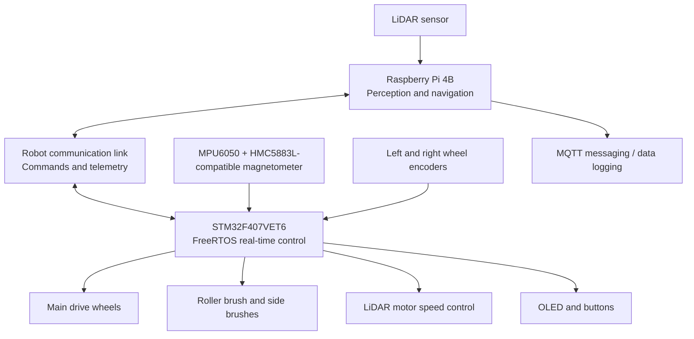

# Moppy 2.0 — Autonomous Floor-Cleaning Robot

Moppy 2.0 is an in-development autonomous floor-cleaning robot that combines an **STM32F407VET6 real-time controller** with a **Raspberry Pi 4B (4 GB)** for higher-level processing. The STM32 manages time-sensitive motor and sensor tasks; the Raspberry Pi is the platform for LiDAR processing, mapping/navigation work, messaging, and data logging.

The project brings together embedded firmware, motor control, encoder odometry, inertial sensing, LiDAR rotation control, and Linux-side robotics software in one repository.

> **Project status:** Active development. Not every subsystem or end-to-end autonomous behaviour is complete. See [Development Status](#development-status) before trying the robot without supervision.

## Contents

- [System Architecture](#system-architecture)
- [Hardware](#hardware)
- [Software and Firmware](#software-and-firmware)
- [Repository Layout](#repository-layout)
- [STM32 Firmware Architecture](#stm32-firmware-architecture)
- [Raspberry Pi Software](#raspberry-pi-software)
- [Getting Started](#getting-started)
- [Development Status](#development-status)
- [Safety and Test Notes](#safety-and-test-notes)
- [Contributing](#contributing)
- [License](#license)

## System Architecture

The robot is split into two cooperating compute layers.



| Subsystem | Main responsibility |
|---|---|
| **Raspberry Pi 4B** | Hosts the Linux-side LiDAR tools, higher-level navigation work, messaging bridges, and data-logging components. |
| **STM32F407VET6** | Runs real-time firmware for drive motors, cleaning motors, sensors, encoder-based wheel control, and LiDAR motor control. |
| **LiDAR** | Supplies scan data for spatial awareness and mapping work on the Raspberry Pi. |
| **IMU and encoders** | Provide inertial measurements and wheel-motion feedback for motion estimation and control. |
| **OLED and buttons** | Provide local status display and basic user interaction. |

The Raspberry Pi is intended to plan or request motion; the STM32 should retain responsibility for deterministic wheel-control timing. The communication protocol and end-to-end navigation behaviour should be considered works in progress unless verified in the current code and on the physical robot.

## Hardware

The current project design includes the following major components:

- **Main controller:** STM32F407VET6 development board.
- **High-level computer:** Raspberry Pi 4B with 4 GB RAM.
- **Drive system:** Differential drive with left and right DC motors, quadrature encoder feedback, and TB6612FNG-based motor control.
- **Cleaning assembly:** Vacuum blower, roller brush, and side brushes.
- **IMU:** MPU6050 accelerometer/gyroscope.
- **Magnetic heading sensor:** HMC5883L-compatible magnetometer module.
- **Range sensing:** Rotating LiDAR connected to the system for scan acquisition and mapping work.
- **Local interface:** I2C OLED and push buttons.

Refer to the hardware pin map, STM32CubeMX `.ioc` configuration, schematics, and any accompanying wiring documents in the repository before connecting hardware. Confirm pin assignments against the actual board revision; do not rely on example wiring alone.

## Software and Firmware

### Embedded firmware

- C firmware built with **STM32CubeIDE** and the STM32 HAL.
- **FreeRTOS / CMSIS-RTOS v2** for task scheduling.
- Encoder-based wheel odometry and closed-loop wheel-speed control.
- MPU6050 and magnetometer drivers, with DMA-based I2C sampling and bus-recovery handling.
- LiDAR UART reception/parsing and LiDAR-motor speed control.
- Drivers for the drive wheels, brush motors, OLED, and buttons.

### Raspberry Pi software

The Raspberry Pi side contains Python-based LiDAR and supporting scripts, plus MQTT-related messaging and database logging components. The repository's startup script is intended to coordinate the relevant processes. Exact package versions, device paths, broker configuration, and database settings must match the local installation.

## Repository Layout

The repository is organised into two main subsystem folders:

```text
moppy2.0/
├── Moppy 2.0 - R Pi 4B/
│   ├── start_moppy.sh          # Raspberry Pi startup script
│   ├── moppy_lidar_node.py     # LiDAR-related Python process
│   ├── mqtt_bridge.py          # MQTT messaging bridge
│   └── mqtt_to_mysql.py        # MQTT-to-MySQL logging component
├── Moppy 2.0 - STM32/
│   ├── Moppy2.0.ioc            # STM32CubeMX project configuration
│   └── ...                     # Firmware source, headers, and project files
├── README.md
└── LICENSE
```

This is a guide to the primary components, not a guarantee that every filename appears at exactly this path in every revision. Use the repository's current folder contents as the source of truth.

## STM32 Firmware Architecture

The firmware is divided into modules so that time-critical wheel control does not depend on slower UI or communications work.

| RTOS task / module | Responsibility |
|---|---|
| **ImuTask** | Advances the IMU manager and processes completed sensor transfers outside interrupt callbacks. |
| **WheelTask** | Runs chassis control periodically (currently designed around a 20 ms cycle), reads encoder changes, updates wheel-speed control, and applies motor targets. |
| **GeneralTask** | Handles buttons, OLED updates, brush updates, and LiDAR motor PID updates. |
| **TelemetryTask** | Reserved for Raspberry Pi communications and telemetry. Check the current source before assuming a complete command protocol is available. |
| **Chassis controller** | Tracks encoder odometry, ramps wheel targets, and runs separate left/right wheel-speed PID controllers. |
| **IMU manager** | Coordinates MPU6050 and magnetometer transfers, records data validity/timestamps, and handles I2C errors/recovery. |
| **LiDAR motor controller** | Uses received LiDAR status/RPM information to regulate the LiDAR motor. |

### Motion control direction

The chassis API supports wheel-speed targets, and a differential-drive velocity interface can convert requested linear speed and angular rate into left/right wheel targets. **A velocity command is not the same as a completed angle command:** accurate relative turns such as 37° or 90° require a motion state machine, yaw estimation, stopping tolerance, and timeout handling. Verify that these features are implemented before relying on them for navigation.

## Raspberry Pi Software

The Pi-side folder includes the LiDAR-related Python process, an MQTT bridge, a database logging script, and a startup shell script. Before running them on a new Raspberry Pi installation, check the scripts for:

- Required Python packages and the Python environment used by the startup script.
- The LiDAR serial device and baud rate.
- MQTT broker host, port, and topic names.
- MySQL host, database name, table schema, and credentials.
- Absolute paths, permissions, and services that must start first.

Do not commit Wi-Fi passwords, MQTT credentials, database passwords, API keys, or other secrets. Keep deployment-specific values in a local configuration file or environment variables and add private configuration files to `.gitignore`.

## Getting Started

### 1. Clone the repository

```bash
git clone https://github.com/Dmxddrx/moppy2.0.git
cd moppy2.0
```

### 2. Build and flash the STM32 firmware

1. Install STM32CubeIDE and the STM32CubeF4 support package appropriate for the project.
2. Open STM32CubeIDE and import the existing STM32 project from `Moppy 2.0 - STM32/`.
3. Inspect `Moppy2.0.ioc` and verify the target MCU, clocks, GPIO, timers, UARTs, I2C, DMA, and FreeRTOS configuration against the hardware.
4. Build the project and resolve any missing or locally configured middleware before flashing.
5. First test with the drive wheels safely raised and cleaning motors disabled where practical.

The exact build configuration and project-file names can vary by revision; preserve the repository's generated CubeIDE files and make board-specific changes deliberately.

### 3. Prepare the Raspberry Pi

1. Install and update a supported 64-bit Raspberry Pi OS image, then confirm that the SD card has sufficient free space for packages, logs, and map data.
2. Copy or clone the repository onto the Pi.
3. Review `start_moppy.sh` and the Python files before running them. Install the dependencies they actually import, configure the LiDAR device path, and configure the MQTT/database services they expect.
4. From the Raspberry Pi folder, make the startup script executable and run it only after reviewing its commands:

   ```bash
   cd "Moppy 2.0 - R Pi 4B"
   chmod +x start_moppy.sh
   ./start_moppy.sh
   ```

5. Check the console output and service logs to confirm which processes started successfully. A running script does not by itself confirm that LiDAR data, robot commands, or database logging are working end to end.

### 4. Validate each subsystem separately

- Verify encoder direction and counts by turning each wheel by hand while the drive is disabled.
- Test each motor's direction at low PWM before enabling closed-loop control.
- Confirm that the IMU produces fresh readings and that recovery logic is not repeatedly triggering.
- Confirm that LiDAR packets are received and the LiDAR motor reaches its required speed.
- Verify the Pi-side LiDAR process independently before combining it with drive commands.
- Test communication, telemetry, motion commands, obstacle handling, and stop behaviour individually before attempting autonomous movement.

## Development Status

Moppy 2.0 is being developed incrementally. The following reflects the current project direction; implementation details can change between commits.

| Area | Status / note |
|---|---|
| STM32 motor drivers and wheel-speed control | Implemented in firmware; continue tuning and validating under the actual robot load. |
| Encoder-based odometry | Implemented; accuracy depends on encoder configuration, wheel dimensions, floor surface, and calibration. |
| IMU sampling and I2C fault handling | Implemented; verify yaw estimation and recovery behaviour in the exact firmware revision being tested. |
| LiDAR motor RPM regulation | Firmware work is present; validate RPM feedback and steady-state operation with the actual LiDAR and drive mechanism. |
| RTOS task separation | Dedicated IMU, wheel, general-control, and telemetry task structure is present; confirm task-creation and watchdog behaviour on the target. |
| Raspberry Pi LiDAR processing and supporting scripts | Scripts are present; deployment dependencies, startup sequence, and hardware device paths must be configured for the target Pi. |
| Raspberry Pi ↔ STM32 command/telemetry integration | Treat as in progress until the exact protocol, receiving/transmitting code, timeout behaviour, and hardware link are verified together. |
| IMU-corrected exact-angle turns | Further yaw estimation, turn-state logic, stopping criteria, and physical calibration are required unless implemented in the current branch. |
| End-to-end autonomous mapping and path following | Work in progress; validate on the real robot before describing it as fully autonomous. |

## Safety and Test Notes

This project controls moving motors, rotating cleaning hardware, and a mobile robot. For development and debugging:

- Raise the drive wheels for initial motor-direction and control-loop tests.
- Keep fingers, cables, clothing, and test leads away from wheels, brushes, belts, and the LiDAR rotor.
- Provide a reachable power disconnect and test emergency-stop behaviour before autonomous operation.
- Start with low speed, a clear test area, and a person ready to stop the robot.
- Do not rely on LiDAR mapping alone as a safety-rated collision-avoidance system.
- Confirm that communication loss, stale sensor data, task failure, and watchdog resets lead to a safe motor state.

## Contributing

Suggestions, bug reports, and improvements are welcome. When reporting a problem, include the hardware revision, relevant firmware/Pi software revision, the steps to reproduce it, and useful serial or system logs. Remove credentials and other private information from logs before posting them.

## License

This project is licensed under the MIT License.
See the [LICENSE.md](LICENSE.md) file for details.
